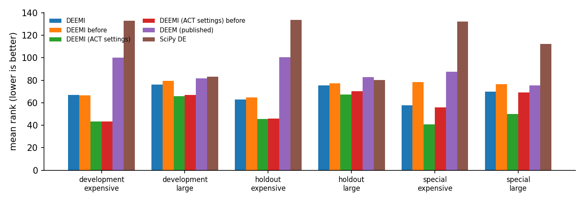

# Validation

This page documents the benchmark used to validate the changes to DEEMI of
16.11.2026 and to compare DEEMI with the published DEEM and with SciPy's
`differential_evolution`. The harness is `example/deemi_validation.py`; every
number below can be reproduced with the commands at the end of the page.

## Method

**Test functions.** Every function is shifted so that its optimum $x^*$ lies at a
random point of $[-4, 4]^d$ (not at the origin and not at the centre of the box
$[-5, 5]^d$); functions marked *rot* are additionally rotated by a random orthogonal
matrix, so separability cannot be exploited. The instance (shift, rotation) depends
only on the function and the dimension, not on the seed. $f(x^*) = 0$, so the
objective value is the error.

| set | functions | role |
|---|---|---|
| development | sphere, ellipsoid-rot (condition $10^6$), rosenbrock, rastrigin-rot, ackley-rot | used to screen and tune candidates |
| hold-out | bent_cigar-rot, schwefel12, griewank-rot, levy-rot, weierstrass-rot | used to judge a candidate (never tuned on) |
| special: NaN | ellipsoid-rot-nan, rastrigin-rot-nan | the objective returns NaN in a half-space (about half of the box) next to the optimum |
| special: scaled | ellipsoid-rot-scaled, rastrigin-rot-scaled, rosenbrock-scaled | parameter ranges differ by six orders of magnitude ($10^{-3}$ to $10^{3}$ times the reference range) |

**Dimensions and budgets.** $d = 5, 10, 20$. Two budget regimes: *expensive*,
$B = 100\,d$ evaluations (500 to 2000, the regime of finite-element calibration),
and *large*, $B = 2000\,d$ evaluations (10 000 to 40 000). 25 seeds (0 to 24) per
configuration.

**Equal budgets.** All algorithms call the same wrapper, which records the best true
objective value among the first $B$ evaluations; evaluations beyond $B$ are ignored.
For DEEM/DEEMI, `maxfev = B` and `maxiter` is chosen so that the planned generations
use the budget (with a shrinking population from its mean size).

**Algorithms.**

| name | configuration |
|---|---|
| DEEMI | `DEEM.DEEMI` with its defaults after the changes of 16.11.2026 (50 candidates, 10 to 2 sub-populations) |
| DEEMI before | the same settings with the code before 16.11.2026 |
| DEEMI (ACT settings) | the settings numgeo-ACT uses: fitness-focused sub-populations, exponential reduction from 4 to 2 sub-populations, `damping-periodic` bounds, population $\min(60, \max(24, 6d))$ shrinking to one half |
| DEEM (published) | `DEEM.DEEM`, the published algorithm (with the defect corrections of 16.11.2026), 50 candidates |
| SciPy DE | `scipy.optimize.differential_evolution`, defaults (`best1bin`, population $15d$, Latin hypercube initialisation), no polishing |

**Statistics.** Rank based throughout: median and interquartile range per
configuration; per configuration a two-sided Mann-Whitney U test at 5 % gives a win,
tie or loss (counted from the point of view of the algorithm in the row); across the
15 configurations of a set and regime the Wilcoxon signed-rank test compares the
paired median errors (log scale) with the reference; the mean rank pools all runs of
a configuration; the success rate is the share of runs reaching an error
$\le 10^{-8}$.



## Results: DEEMI against the baselines

### Development set, expensive regime

| algorithm | mean rank | success rate | wins / ties / losses vs reference | Wilcoxon p (vs reference) | median of log10 error ratio |
|---|---|---|---|---|---|
| DEEMI | 66.77 | 0 % | - | - | - |
| DEEMI before | 66.64 | 0 % | 0 / 15 / 0 | 0.308 | +0.00 |
| DEEMI (ACT settings) | 43.16 | 0 % | 8 / 7 / 0 | 0.000183 | -0.19 |
| DEEMI (ACT settings) before | 43.42 | 0 % | 7 / 8 / 0 | 0.000183 | -0.19 |
| DEEM (published) | 100.22 | 0 % | 1 / 1 / 13 | 0.000183 | +0.34 |
| SciPy DE | 132.78 | 0 % | 0 / 0 / 15 | 6.1e-05 | +0.69 |

??? note "Median error [IQR] per function and dimension (development set, expensive regime)"

    | function | d | DEEMI | DEEMI before | DEEMI (ACT settings) | DEEMI (ACT settings) before | DEEM (published) | SciPy DE |
    |---|---|---|---|---|---|---|---|
    | ackley-rot | 5 | 1.54e+00 [9.99e-01, 2.04e+00] | 1.69e+00 [1.19e+00, 2.09e+00] | **4.44e-01 [2.03e-01, 9.46e-01]** | 5.09e-01 [2.03e-01, 9.46e-01] | 2.36e+00 [1.73e+00, 2.81e+00] | 2.94e+00 [2.66e+00, 3.22e+00] |
    | ackley-rot | 10 | 2.02e+00 [1.62e+00, 2.36e+00] | 2.16e+00 [1.88e+00, 2.61e+00] | **1.91e+00 [1.59e+00, 2.11e+00]** | 1.93e+00 [1.61e+00, 2.30e+00] | 2.92e+00 [2.73e+00, 3.15e+00] | 4.21e+00 [3.84e+00, 4.60e+00] |
    | ackley-rot | 20 | **2.12e+00 [1.85e+00, 2.61e+00]** | **2.12e+00 [1.85e+00, 2.61e+00]** | 2.37e+00 [2.08e+00, 2.69e+00] | 2.36e+00 [2.08e+00, 2.69e+00] | 2.81e+00 [2.66e+00, 3.10e+00] | 6.28e+00 [6.06e+00, 6.85e+00] |
    | ellipsoid-rot | 5 | 7.49e+02 [2.32e+02, 1.13e+03] | 7.80e+02 [3.96e+02, 1.72e+03] | **1.77e+02 [6.96e+01, 3.36e+02]** | 2.23e+02 [1.03e+02, 3.61e+02] | 1.62e+03 [1.00e+03, 2.27e+03] | 4.27e+03 [2.88e+03, 6.57e+03] |
    | ellipsoid-rot | 10 | 6.97e+03 [2.78e+03, 9.54e+03] | 4.39e+03 [2.31e+03, 9.54e+03] | **3.80e+03 [1.77e+03, 6.52e+03]** | **3.80e+03 [1.78e+03, 6.52e+03]** | 1.53e+04 [1.05e+04, 1.90e+04] | 6.32e+04 [5.14e+04, 8.57e+04] |
    | ellipsoid-rot | 20 | 2.98e+04 [2.27e+04, 4.22e+04] | 2.86e+04 [2.15e+04, 4.22e+04] | **2.58e+04 [1.55e+04, 4.04e+04]** | 2.67e+04 [1.55e+04, 4.04e+04] | 8.94e+04 [4.97e+04, 1.06e+05] | 5.22e+05 [3.94e+05, 5.84e+05] |
    | rastrigin-rot | 5 | 1.63e+01 [1.34e+01, 2.02e+01] | 1.45e+01 [1.30e+01, 1.80e+01] | **9.25e+00 [6.80e+00, 1.13e+01]** | 9.57e+00 [6.70e+00, 1.17e+01] | 1.90e+01 [1.34e+01, 2.12e+01] | 2.10e+01 [1.81e+01, 2.54e+01] |
    | rastrigin-rot | 10 | 5.48e+01 [5.06e+01, 6.32e+01] | 5.43e+01 [5.13e+01, 5.77e+01] | 4.80e+01 [4.06e+01, 5.46e+01] | **4.57e+01 [3.73e+01, 5.46e+01]** | 4.62e+01 [4.29e+01, 5.29e+01] | 7.78e+01 [7.16e+01, 8.20e+01] |
    | rastrigin-rot | 20 | 9.25e+01 [7.45e+01, 1.14e+02] | 9.49e+01 [7.45e+01, 1.18e+02] | **7.62e+01 [6.42e+01, 1.00e+02]** | **7.62e+01 [6.42e+01, 1.07e+02]** | 1.25e+02 [1.04e+02, 1.41e+02] | 1.95e+02 [1.90e+02, 2.08e+02] |
    | rosenbrock | 5 | 1.39e+01 [1.07e+01, 2.05e+01] | 1.61e+01 [1.13e+01, 2.25e+01] | **3.02e+00 [1.57e+00, 4.62e+00]** | 3.13e+00 [2.37e+00, 4.59e+00] | 3.38e+01 [1.67e+01, 4.59e+01] | 6.74e+01 [3.49e+01, 1.19e+02] |
    | rosenbrock | 10 | 7.52e+01 [3.83e+01, 1.25e+02] | 6.68e+01 [3.73e+01, 1.07e+02] | **6.12e+01 [3.34e+01, 9.58e+01]** | **6.12e+01 [3.00e+01, 9.58e+01]** | 1.63e+02 [1.40e+02, 2.46e+02] | 1.27e+03 [7.87e+02, 1.79e+03] |
    | rosenbrock | 20 | 2.31e+02 [1.80e+02, 3.15e+02] | 2.31e+02 [1.80e+02, 3.15e+02] | **2.05e+02 [1.26e+02, 2.55e+02]** | **2.05e+02 [1.26e+02, 2.55e+02]** | 3.67e+02 [3.15e+02, 4.67e+02] | 1.51e+04 [1.08e+04, 2.30e+04] |
    | sphere | 5 | 1.38e-01 [9.70e-02, 2.01e-01] | 1.24e-01 [8.30e-02, 2.31e-01] | 8.94e-03 [1.92e-03, 2.36e-02] | **8.49e-03 [3.34e-03, 2.27e-02]** | 3.20e-01 [2.71e-01, 4.40e-01] | 4.76e-01 [4.04e-01, 8.95e-01] |
    | sphere | 10 | 2.33e-01 [1.28e-01, 2.88e-01] | 1.97e-01 [1.44e-01, 2.82e-01] | **1.51e-01 [1.05e-01, 2.38e-01]** | **1.51e-01 [1.05e-01, 2.38e-01]** | 1.28e+00 [8.84e-01, 1.65e+00] | 5.67e+00 [4.82e+00, 7.66e+00] |
    | sphere | 20 | 4.13e-01 [2.53e-01, 6.45e-01] | 4.13e-01 [2.53e-01, 6.45e-01] | **2.16e-01 [1.36e-01, 3.09e-01]** | **2.16e-01 [1.36e-01, 3.09e-01]** | 1.25e+00 [1.03e+00, 1.63e+00] | 3.21e+01 [2.76e+01, 3.50e+01] |

### Development set, large regime

| algorithm | mean rank | success rate | wins / ties / losses vs reference | Wilcoxon p (vs reference) | median of log10 error ratio |
|---|---|---|---|---|---|
| DEEMI | 76.25 | 17 % | - | - | - |
| DEEMI before | 79.33 | 18 % | 0 / 14 / 1 | 0.229 | +0.02 |
| DEEMI (ACT settings) | 65.89 | 19 % | 8 / 4 / 3 | 0.421 | -0.11 |
| DEEMI (ACT settings) before | 66.99 | 19 % | 7 / 5 / 3 | 0.277 | -0.12 |
| DEEM (published) | 81.56 | 14 % | 1 / 10 / 4 | 0.679 | +0.00 |
| SciPy DE | 82.98 | 20 % | 5 / 3 / 7 | 0.978 | +0.17 |

??? note "Median error [IQR] per function and dimension (development set, large regime)"

    | function | d | DEEMI | DEEMI before | DEEMI (ACT settings) | DEEMI (ACT settings) before | DEEM (published) | SciPy DE |
    |---|---|---|---|---|---|---|---|
    | ackley-rot | 5 | 7.34e-05 [2.81e-05, 1.59e-04] | 1.24e-04 [5.22e-05, 2.23e-04] | 2.84e-06 [4.96e-07, 1.04e-05] | 3.75e-06 [7.75e-07, 1.16e-05] | 5.87e-04 [4.47e-04, 7.07e-04] | **2.76e-10 [1.15e-10, 4.36e-10]** |
    | ackley-rot | 10 | 5.69e-06 [9.37e-07, 3.35e-05] | 9.07e-06 [2.62e-06, 3.26e-05] | 4.22e-05 [3.03e-05, 6.72e-05] | 5.16e-05 [2.38e-05, 8.25e-05] | **1.80e-06 [3.72e-07, 2.29e-05]** | 1.52e-05 [7.84e-06, 2.50e-05] |
    | ackley-rot | 20 | 1.16e+00 [5.97e-05, 1.84e+00] | 1.16e+00 [2.57e-04, 1.84e+00] | 2.23e-05 [6.21e-06, 6.51e-05] | **1.64e-05 [9.54e-06, 8.54e-05]** | 1.42e+00 [1.16e+00, 1.84e+00] | 8.34e-03 [5.75e-03, 1.15e-02] |
    | ellipsoid-rot | 5 | 2.56e-01 [2.53e-02, 4.29e-01] | 3.66e-01 [2.53e-02, 5.92e-01] | 2.08e-03 [9.88e-04, 4.20e-03] | 1.46e-03 [3.76e-04, 5.66e-03] | 2.85e+00 [1.15e+00, 8.72e+00] | **1.30e-03 [9.49e-04, 3.00e-03]** |
    | ellipsoid-rot | 10 | 2.31e-01 [1.10e-01, 8.35e-01] | 2.18e-01 [1.23e-01, 1.10e+00] | **5.28e-02 [2.93e-02, 9.51e-02]** | **5.28e-02 [4.14e-02, 1.49e-01]** | 4.45e+00 [3.47e+00, 2.30e+01] | 1.34e+03 [9.06e+02, 1.66e+03] |
    | ellipsoid-rot | 20 | 3.09e+02 [2.23e+02, 4.96e+02] | 3.29e+02 [2.08e+02, 4.62e+02] | **1.75e+02 [7.84e+01, 2.93e+02]** | **1.75e+02 [7.84e+01, 2.93e+02]** | 2.64e+02 [1.29e+02, 4.81e+02] | 4.41e+04 [3.10e+04, 5.54e+04] |
    | rastrigin-rot | 5 | 3.98e+00 [1.99e+00, 5.97e+00] | 2.98e+00 [1.99e+00, 5.97e+00] | **1.99e+00 [1.99e+00, 3.98e+00]** | 2.98e+00 [1.99e+00, 3.98e+00] | 2.98e+00 [2.98e+00, 4.97e+00] | 3.34e+00 [2.76e+00, 4.38e+00] |
    | rastrigin-rot | 10 | 1.59e+01 [1.39e+01, 2.59e+01] | 1.50e+01 [1.10e+01, 2.59e+01] | 1.45e+01 [9.95e+00, 1.69e+01] | **1.39e+01 [1.09e+01, 1.69e+01]** | 1.59e+01 [9.95e+00, 2.09e+01] | 3.72e+01 [3.25e+01, 3.89e+01] |
    | rastrigin-rot | 20 | 5.27e+01 [4.38e+01, 6.67e+01] | 5.27e+01 [4.38e+01, 6.67e+01] | **4.08e+01 [2.98e+01, 4.68e+01]** | 4.18e+01 [3.28e+01, 4.68e+01] | 4.68e+01 [3.58e+01, 5.97e+01] | 1.18e+02 [1.12e+02, 1.30e+02] |
    | rosenbrock | 5 | 2.10e-04 [9.37e-05, 1.50e-03] | 3.58e-04 [8.21e-05, 1.34e-03] | 7.62e-03 [2.06e-03, 4.54e-02] | 2.54e-02 [1.11e-03, 6.25e-02] | 9.68e-04 [4.42e-04, 2.44e-03] | **3.60e-06 [1.99e-06, 8.34e-06]** |
    | rosenbrock | 10 | 3.06e+00 [1.44e+00, 3.86e+00] | 4.09e+00 [3.06e+00, 4.41e+00] | 3.53e+00 [8.58e-01, 5.10e+00] | 4.00e+00 [1.62e+00, 4.88e+00] | 1.86e+00 [1.28e-01, 3.90e+00] | **1.82e+00 [1.42e+00, 2.37e+00]** |
    | rosenbrock | 20 | 1.09e+01 [6.99e+00, 1.29e+01] | **1.09e+01 [8.11e+00, 1.40e+01]** | 1.27e+01 [1.06e+01, 1.39e+01] | 1.32e+01 [1.05e+01, 1.45e+01] | 1.22e+01 [8.85e+00, 1.45e+01] | 1.59e+01 [1.52e+01, 1.71e+01] |
    | sphere | 5 | 1.86e-09 [3.44e-10, 1.39e-08] | 1.94e-09 [2.48e-10, 9.90e-09] | 5.13e-12 [2.42e-13, 7.50e-11] | 1.01e-11 [1.05e-12, 8.94e-11] | 1.63e-07 [6.65e-08, 2.89e-07] | **2.66e-21 [7.46e-22, 8.12e-21]** |
    | sphere | 10 | 1.03e-12 [1.79e-14, 6.64e-10] | 5.46e-11 [2.19e-13, 6.28e-10] | 8.77e-10 [7.18e-11, 4.53e-09] | 6.99e-10 [1.97e-10, 2.63e-09] | **2.52e-13 [5.82e-15, 1.13e-11]** | 6.96e-11 [2.67e-11, 2.07e-10] |
    | sphere | 20 | 3.79e-10 [4.43e-12, 3.08e-09] | 4.62e-11 [3.11e-12, 2.36e-10] | 7.55e-10 [3.02e-10, 2.04e-09] | 1.33e-10 [2.41e-11, 1.23e-09] | **6.64e-14 [2.52e-15, 1.24e-11]** | 4.02e-05 [2.37e-05, 5.99e-05] |

### Holdout set, expensive regime

| algorithm | mean rank | success rate | wins / ties / losses vs reference | Wilcoxon p (vs reference) | median of log10 error ratio |
|---|---|---|---|---|---|
| DEEMI | 62.79 | 0 % | - | - | - |
| DEEMI before | 64.65 | 0 % | 0 / 15 / 0 | 0.155 | +0.00 |
| DEEMI (ACT settings) | 45.50 | 0 % | 7 / 7 / 1 | 0.0125 | -0.13 |
| DEEMI (ACT settings) before | 45.91 | 0 % | 7 / 7 / 1 | 0.0125 | -0.13 |
| DEEM (published) | 100.60 | 0 % | 0 / 2 / 13 | 0.000427 | +0.33 |
| SciPy DE | 133.54 | 0 % | 0 / 0 / 15 | 6.1e-05 | +0.77 |

??? note "Median error [IQR] per function and dimension (holdout set, expensive regime)"

    | function | d | DEEMI | DEEMI before | DEEMI (ACT settings) | DEEMI (ACT settings) before | DEEM (published) | SciPy DE |
    |---|---|---|---|---|---|---|---|
    | bent_cigar-rot | 5 | 2.88e+04 [1.55e+04, 5.82e+04] | 3.23e+04 [1.86e+04, 7.54e+04] | **1.22e+03 [6.68e+02, 2.64e+03]** | 1.50e+03 [6.65e+02, 3.42e+03] | 1.33e+05 [8.55e+04, 2.05e+05] | 2.67e+05 [1.68e+05, 3.23e+05] |
    | bent_cigar-rot | 10 | 1.78e+05 [9.65e+04, 2.74e+05] | 1.90e+05 [1.17e+05, 3.10e+05] | **1.31e+05 [8.55e+04, 1.82e+05]** | **1.31e+05 [8.55e+04, 1.82e+05]** | 7.21e+05 [5.33e+05, 8.37e+05] | 4.43e+06 [3.51e+06, 5.18e+06] |
    | bent_cigar-rot | 20 | 2.67e+05 [2.10e+05, 3.74e+05] | 2.67e+05 [2.10e+05, 3.74e+05] | **1.96e+05 [1.57e+05, 3.68e+05]** | **1.96e+05 [1.57e+05, 3.68e+05]** | 9.91e+05 [8.03e+05, 1.48e+06] | 2.68e+07 [2.28e+07, 3.20e+07] |
    | griewank-rot | 5 | 1.17e+00 [1.04e+00, 1.32e+00] | 1.24e+00 [1.14e+00, 1.45e+00] | **7.36e-01 [5.87e-01, 8.27e-01]** | 7.68e-01 [5.52e-01, 8.65e-01] | 1.99e+00 [1.54e+00, 2.86e+00] | 2.44e+00 [1.95e+00, 3.39e+00] |
    | griewank-rot | 10 | 1.83e+00 [1.48e+00, 2.08e+00] | 1.83e+00 [1.52e+00, 2.20e+00] | **1.41e+00 [1.25e+00, 1.45e+00]** | **1.41e+00 [1.29e+00, 1.45e+00]** | 3.89e+00 [3.01e+00, 5.27e+00] | 1.65e+01 [1.23e+01, 2.05e+01] |
    | griewank-rot | 20 | 2.22e+00 [1.96e+00, 2.74e+00] | 2.22e+00 [1.96e+00, 2.74e+00] | **1.78e+00 [1.53e+00, 1.96e+00]** | **1.78e+00 [1.53e+00, 1.96e+00]** | 4.87e+00 [3.64e+00, 5.34e+00] | 7.62e+01 [6.16e+01, 8.76e+01] |
    | levy-rot | 5 | 5.18e-02 [3.57e-02, 9.95e-02] | 7.91e-02 [5.10e-02, 1.19e-01] | **7.02e-03 [2.57e-03, 3.33e-02]** | 7.37e-03 [2.57e-03, 3.33e-02] | 2.22e-01 [1.65e-01, 3.26e-01] | 2.87e-01 [1.74e-01, 4.89e-01] |
    | levy-rot | 10 | 3.84e-01 [2.90e-01, 6.38e-01] | **3.78e-01 [2.84e-01, 6.38e-01]** | 5.75e-01 [2.72e-01, 7.50e-01] | 5.75e-01 [2.88e-01, 7.50e-01] | 5.73e-01 [3.78e-01, 8.91e-01] | 2.06e+00 [1.57e+00, 2.48e+00] |
    | levy-rot | 20 | 2.51e+00 [1.58e+00, 3.30e+00] | 2.51e+00 [1.58e+00, 3.30e+00] | **1.29e+00 [1.06e+00, 2.49e+00]** | **1.29e+00 [1.06e+00, 2.49e+00]** | 1.94e+00 [1.25e+00, 3.32e+00] | 1.08e+01 [9.02e+00, 1.19e+01] |
    | schwefel12 | 5 | 1.59e-01 [8.42e-02, 3.85e-01] | 2.23e-01 [1.22e-01, 3.85e-01] | 5.70e-02 [3.66e-02, 6.50e-02] | **5.25e-02 [3.30e-02, 8.00e-02]** | 7.36e-01 [5.97e-01, 1.08e+00] | 9.37e-01 [7.55e-01, 1.45e+00] |
    | schwefel12 | 10 | 1.08e+00 [9.19e-01, 1.53e+00] | 1.08e+00 [8.51e-01, 1.47e+00] | **1.04e+00 [7.43e-01, 1.61e+00]** | 1.05e+00 [6.97e-01, 1.61e+00] | 4.38e+00 [3.39e+00, 5.72e+00] | 1.08e+01 [9.04e+00, 1.25e+01] |
    | schwefel12 | 20 | 8.59e+00 [7.10e+00, 9.71e+00] | 9.15e+00 [7.10e+00, 1.05e+01] | **7.98e+00 [6.99e+00, 1.00e+01]** | 8.36e+00 [7.02e+00, 1.00e+01] | 1.82e+01 [1.57e+01, 2.18e+01] | 6.27e+01 [5.13e+01, 7.22e+01] |
    | weierstrass-rot | 5 | 2.35e+00 [1.69e+00, 2.70e+00] | 2.11e+00 [1.83e+00, 2.90e+00] | 1.61e+00 [9.05e-01, 2.24e+00] | **1.58e+00 [8.54e-01, 2.39e+00]** | 2.87e+00 [2.28e+00, 3.22e+00] | 3.68e+00 [3.22e+00, 4.22e+00] |
    | weierstrass-rot | 10 | 6.48e+00 [5.70e+00, 6.92e+00] | **5.95e+00 [5.49e+00, 7.15e+00]** | 7.21e+00 [5.38e+00, 7.73e+00] | 6.75e+00 [5.26e+00, 7.67e+00] | 7.42e+00 [6.30e+00, 7.93e+00] | 1.04e+01 [9.94e+00, 1.12e+01] |
    | weierstrass-rot | 20 | **1.35e+01 [1.21e+01, 1.52e+01]** | 1.39e+01 [1.17e+01, 1.52e+01] | 1.56e+01 [1.40e+01, 1.79e+01] | 1.56e+01 [1.45e+01, 1.79e+01] | 1.50e+01 [1.39e+01, 1.74e+01] | 2.58e+01 [2.49e+01, 2.64e+01] |

### Holdout set, large regime

| algorithm | mean rank | success rate | wins / ties / losses vs reference | Wilcoxon p (vs reference) | median of log10 error ratio |
|---|---|---|---|---|---|
| DEEMI | 75.25 | 6 % | - | - | - |
| DEEMI before | 77.15 | 5 % | 0 / 14 / 1 | 0.277 | +0.00 |
| DEEMI (ACT settings) | 67.37 | 8 % | 5 / 8 / 2 | 0.359 | -0.14 |
| DEEMI (ACT settings) before | 70.21 | 6 % | 5 / 8 / 2 | 0.561 | -0.16 |
| DEEM (published) | 82.86 | 5 % | 0 / 13 / 2 | 0.0637 | +0.16 |
| SciPy DE | 80.17 | 15 % | 7 / 1 / 7 | 0.804 | +0.09 |

??? note "Median error [IQR] per function and dimension (holdout set, large regime)"

    | function | d | DEEMI | DEEMI before | DEEMI (ACT settings) | DEEMI (ACT settings) before | DEEM (published) | SciPy DE |
    |---|---|---|---|---|---|---|---|
    | bent_cigar-rot | 5 | 2.78e-01 [2.76e-02, 4.44e+00] | 4.93e-01 [3.63e-02, 2.72e+00] | 7.39e-03 [1.67e-03, 1.54e-01] | 5.68e-03 [1.19e-03, 1.10e-01] | 7.11e+00 [2.95e-01, 1.43e+01] | **4.91e-03 [4.10e-03, 1.15e-02]** |
    | bent_cigar-rot | 10 | 5.94e+00 [9.57e-01, 9.29e+00] | 6.06e+00 [1.29e+00, 9.37e+00] | **8.42e-01 [8.71e-02, 4.37e+00]** | 8.42e-01 [7.44e-02, 4.37e+00] | 2.94e+00 [8.67e-01, 1.12e+01] | 1.06e+02 [4.65e+01, 3.45e+02] |
    | bent_cigar-rot | 20 | 1.56e+01 [5.63e+00, 2.60e+01] | 1.57e+01 [5.56e+00, 2.61e+01] | 1.05e+01 [1.83e+00, 3.03e+01] | **1.02e+01 [1.85e+00, 3.04e+01]** | 1.44e+01 [3.95e+00, 2.58e+01] | 3.66e+02 [1.99e+02, 1.07e+03] |
    | griewank-rot | 5 | **5.91e-02 [4.19e-02, 1.38e-01]** | 6.16e-02 [4.19e-02, 1.18e-01] | 7.14e-02 [4.68e-02, 1.36e-01] | 6.90e-02 [5.18e-02, 1.26e-01] | 9.86e-02 [6.16e-02, 1.33e-01] | 1.59e-01 [1.31e-01, 2.00e-01] |
    | griewank-rot | 10 | 8.11e-02 [6.15e-02, 1.31e-01] | 8.11e-02 [6.15e-02, 1.18e-01] | **7.69e-02 [6.22e-02, 9.61e-02]** | 7.70e-02 [6.21e-02, 9.46e-02] | 8.87e-02 [6.40e-02, 1.21e-01] | 5.96e-01 [5.20e-01, 6.67e-01] |
    | griewank-rot | 20 | 1.52e-02 [7.40e-03, 2.21e-02] | **1.48e-02 [1.43e-04, 2.22e-02]** | 2.47e-02 [9.89e-03, 2.73e-02] | 2.46e-02 [1.03e-02, 2.77e-02] | 2.21e-02 [9.87e-03, 2.95e-02] | 2.96e-01 [1.76e-01, 7.70e-01] |
    | levy-rot | 5 | 3.79e-08 [9.41e-09, 1.58e-07] | 1.71e-07 [3.66e-08, 1.45e-06] | 1.36e-09 [1.38e-10, 1.45e-08] | 6.27e-09 [5.49e-10, 5.40e-08] | 6.39e-08 [1.27e-08, 2.51e-07] | **1.83e-16 [3.61e-17, 8.86e-16]** |
    | levy-rot | 10 | 1.90e-08 [4.46e-10, 4.54e-01] | **8.40e-09 [5.77e-10, 5.91e-08]** | 6.24e-07 [4.39e-07, 1.58e-06] | 7.71e-07 [2.43e-07, 1.37e-06] | 8.95e-02 [8.58e-10, 8.95e-02] | 2.36e-08 [8.40e-09, 6.22e-08] |
    | levy-rot | 20 | 1.91e+00 [9.02e-01, 2.73e+00] | 1.91e+00 [9.02e-01, 2.73e+00] | 1.79e-01 [8.95e-02, 5.44e-01] | 8.95e-02 [8.95e-02, 1.79e-01] | 8.12e-01 [5.44e-01, 2.36e+00] | **9.17e-04 [4.18e-04, 1.32e-02]** |
    | schwefel12 | 5 | 1.46e-06 [4.67e-07, 1.92e-06] | 9.06e-07 [2.91e-07, 5.12e-06] | 1.63e-08 [1.29e-09, 6.44e-08] | 1.01e-07 [8.85e-09, 2.88e-07] | 1.66e-06 [1.07e-06, 3.63e-06] | **6.39e-13 [5.36e-14, 1.31e-12]** |
    | schwefel12 | 10 | **1.66e-07 [5.01e-08, 5.40e-07]** | 4.23e-07 [1.09e-07, 9.20e-07] | 5.04e-06 [2.60e-06, 1.34e-05] | 8.79e-06 [2.92e-06, 1.41e-05] | 2.14e-06 [6.29e-07, 3.87e-06] | 1.93e-03 [7.15e-04, 2.15e-03] |
    | schwefel12 | 20 | **3.12e-06 [1.02e-06, 2.53e-05]** | 1.06e-05 [4.46e-06, 1.82e-05] | 7.64e-05 [3.91e-05, 1.06e-04] | 1.05e-04 [8.49e-05, 1.80e-04] | 6.79e-06 [1.48e-06, 2.12e-05] | 5.01e+00 [4.13e+00, 8.18e+00] |
    | weierstrass-rot | 5 | 4.79e-02 [1.67e-02, 1.86e-01] | 9.86e-02 [4.20e-02, 5.86e-01] | 1.80e-02 [9.60e-03, 3.82e-02] | 2.98e-02 [1.12e-02, 1.02e-01] | 8.95e-02 [8.49e-03, 5.19e-01] | **9.82e-05 [6.43e-05, 2.10e-04]** |
    | weierstrass-rot | 10 | 2.86e+00 [2.44e+00, 4.19e+00] | 2.83e+00 [2.54e+00, 4.18e+00] | 2.06e+00 [1.33e+00, 3.33e+00] | 1.98e+00 [1.25e+00, 3.55e+00] | 2.87e+00 [2.29e+00, 3.77e+00] | **1.49e-01 [9.50e-02, 3.41e-01]** |
    | weierstrass-rot | 20 | 1.09e+01 [8.17e+00, 1.29e+01] | 1.05e+01 [8.08e+00, 1.28e+01] | 8.76e+00 [7.05e+00, 1.07e+01] | 8.68e+00 [7.10e+00, 1.09e+01] | 1.08e+01 [8.86e+00, 1.33e+01] | **6.86e+00 [5.13e+00, 1.12e+01]** |

### Special set, expensive regime

| algorithm | mean rank | success rate | wins / ties / losses vs reference | Wilcoxon p (vs reference) | median of log10 error ratio |
|---|---|---|---|---|---|
| DEEMI | 57.87 | 0 % | - | - | - |
| DEEMI before | 78.51 | 0 % | 0 / 10 / 5 | 0.00427 | +0.12 |
| DEEMI (ACT settings) | 40.83 | 0 % | 6 / 9 / 0 | 6.1e-05 | -0.06 |
| DEEMI (ACT settings) before | 55.96 | 0 % | 6 / 6 / 3 | 0.33 | -0.07 |
| DEEM (published) | 87.61 | 0 % | 0 / 4 / 11 | 0.000427 | +0.35 |
| SciPy DE | 132.22 | 0 % | 0 / 0 / 15 | 6.1e-05 | +0.73 |

??? note "Median error [IQR] per function and dimension (special set, expensive regime)"

    | function | d | DEEMI | DEEMI before | DEEMI (ACT settings) | DEEMI (ACT settings) before | DEEM (published) | SciPy DE |
    |---|---|---|---|---|---|---|---|
    | ellipsoid-rot-nan | 5 | 8.47e+02 [4.31e+02, 1.57e+03] | 5.78e+03 [3.29e+03, 2.53e+04] | **3.90e+02 [2.04e+02, 8.65e+02]** | 3.13e+03 [1.81e+03, 9.02e+03] | 2.38e+03 [6.85e+02, 4.90e+03] | 6.48e+04 [3.44e+04, 1.75e+05] |
    | ellipsoid-rot-nan | 10 | 5.38e+03 [3.72e+03, 1.03e+04] | 8.66e+03 [3.76e+03, 1.07e+04] | 4.22e+03 [2.02e+03, 5.77e+03] | **3.71e+03 [2.23e+03, 5.93e+03]** | 1.98e+04 [1.24e+04, 2.56e+04] | 1.00e+05 [7.92e+04, 1.44e+05] |
    | ellipsoid-rot-nan | 20 | 2.60e+04 [1.99e+04, 3.95e+04] | 3.92e+05 [2.33e+05, 9.50e+05] | **2.37e+04 [1.74e+04, 3.19e+04]** | 3.24e+05 [1.82e+05, 5.46e+05] | 6.25e+04 [4.59e+04, 9.25e+04] | 1.83e+06 [1.34e+06, 2.14e+06] |
    | ellipsoid-rot-scaled | 5 | 7.89e+02 [2.32e+02, 1.78e+03] | 1.04e+03 [7.24e+02, 1.56e+03] | **1.40e+02 [8.83e+01, 3.45e+02]** | 2.44e+02 [1.98e+02, 4.46e+02] | 2.96e+03 [1.14e+03, 3.52e+03] | 4.27e+03 [2.88e+03, 6.57e+03] |
    | ellipsoid-rot-scaled | 10 | 4.44e+03 [2.77e+03, 7.81e+03] | 4.65e+03 [2.71e+03, 7.21e+03] | 3.80e+03 [1.78e+03, 7.05e+03] | **3.09e+03 [1.57e+03, 6.86e+03]** | 1.70e+04 [1.17e+04, 2.63e+04] | 6.32e+04 [5.14e+04, 8.57e+04] |
    | ellipsoid-rot-scaled | 20 | 2.86e+04 [2.30e+04, 4.22e+04] | 3.08e+04 [2.54e+04, 4.24e+04] | 2.67e+04 [1.55e+04, 4.04e+04] | **2.55e+04 [1.96e+04, 4.53e+04]** | 8.60e+04 [6.16e+04, 1.01e+05] | 5.22e+05 [3.94e+05, 5.84e+05] |
    | rastrigin-rot-nan | 5 | 1.64e+01 [1.24e+01, 2.01e+01] | 2.26e+01 [2.06e+01, 2.74e+01] | **1.19e+01 [9.01e+00, 1.31e+01]** | 1.77e+01 [1.23e+01, 2.14e+01] | 1.99e+01 [1.49e+01, 2.46e+01] | 2.94e+01 [2.74e+01, 3.44e+01] |
    | rastrigin-rot-nan | 10 | 5.44e+01 [4.76e+01, 6.03e+01] | 8.30e+01 [7.12e+01, 9.75e+01] | **5.03e+01 [4.35e+01, 6.27e+01]** | 5.97e+01 [5.02e+01, 7.65e+01] | 5.21e+01 [4.63e+01, 6.07e+01] | 1.13e+02 [1.01e+02, 1.25e+02] |
    | rastrigin-rot-nan | 20 | 1.04e+02 [7.60e+01, 1.30e+02] | 1.62e+02 [1.42e+02, 1.83e+02] | **9.53e+01 [8.30e+01, 1.06e+02]** | 1.33e+02 [9.66e+01, 1.48e+02] | 1.36e+02 [1.19e+02, 1.44e+02] | 2.54e+02 [2.42e+02, 2.63e+02] |
    | rastrigin-rot-scaled | 5 | 1.59e+01 [1.30e+01, 1.92e+01] | 1.84e+01 [1.25e+01, 2.07e+01] | **7.90e+00 [6.86e+00, 1.17e+01]** | 1.07e+01 [7.81e+00, 1.53e+01] | 1.66e+01 [1.43e+01, 2.08e+01] | 2.10e+01 [1.81e+01, 2.54e+01] |
    | rastrigin-rot-scaled | 10 | 5.14e+01 [4.54e+01, 5.72e+01] | 5.17e+01 [4.46e+01, 6.06e+01] | 4.77e+01 [3.96e+01, 5.46e+01] | **4.12e+01 [3.89e+01, 5.14e+01]** | 5.10e+01 [4.37e+01, 5.64e+01] | 7.78e+01 [7.16e+01, 8.20e+01] |
    | rastrigin-rot-scaled | 20 | 8.75e+01 [7.45e+01, 1.01e+02] | 9.64e+01 [7.82e+01, 1.08e+02] | 7.69e+01 [6.22e+01, 1.04e+02] | **7.51e+01 [6.61e+01, 9.32e+01]** | 1.32e+02 [1.13e+02, 1.52e+02] | 1.95e+02 [1.90e+02, 2.08e+02] |
    | rosenbrock-scaled | 5 | 1.39e+01 [1.05e+01, 2.18e+01] | 1.85e+01 [7.28e+00, 2.71e+01] | **2.92e+00 [1.63e+00, 4.43e+00]** | 3.82e+00 [1.53e+00, 8.43e+00] | 3.11e+01 [2.56e+01, 4.09e+01] | 6.74e+01 [3.49e+01, 1.19e+02] |
    | rosenbrock-scaled | 10 | 6.13e+01 [3.83e+01, 1.06e+02] | 4.82e+01 [3.42e+01, 8.66e+01] | 6.12e+01 [3.34e+01, 9.58e+01] | **4.62e+01 [3.27e+01, 9.37e+01]** | 2.14e+02 [1.45e+02, 2.79e+02] | 1.27e+03 [7.87e+02, 1.79e+03] |
    | rosenbrock-scaled | 20 | 2.31e+02 [1.80e+02, 3.15e+02] | 2.06e+02 [1.37e+02, 3.26e+02] | **2.05e+02 [1.26e+02, 2.55e+02]** | 2.47e+02 [1.72e+02, 3.35e+02] | 4.14e+02 [2.98e+02, 5.02e+02] | 1.51e+04 [1.08e+04, 2.30e+04] |

### Special set, large regime

| algorithm | mean rank | success rate | wins / ties / losses vs reference | Wilcoxon p (vs reference) | median of log10 error ratio |
|---|---|---|---|---|---|
| DEEMI | 70.04 | 0 % | - | - | - |
| DEEMI before | 76.33 | 0 % | 2 / 10 / 3 | 0.978 | +0.00 |
| DEEMI (ACT settings) | 50.09 | 0 % | 8 / 6 / 1 | 0.0302 | -0.13 |
| DEEMI (ACT settings) before | 69.09 | 0 % | 6 / 3 / 6 | 0.639 | -0.02 |
| DEEM (published) | 75.29 | 0 % | 0 / 10 / 5 | 0.169 | +0.00 |
| SciPy DE | 112.16 | 0 % | 3 / 1 / 11 | 0.0353 | +0.45 |

??? note "Median error [IQR] per function and dimension (special set, large regime)"

    | function | d | DEEMI | DEEMI before | DEEMI (ACT settings) | DEEMI (ACT settings) before | DEEM (published) | SciPy DE |
    |---|---|---|---|---|---|---|---|
    | ellipsoid-rot-nan | 5 | 2.58e-01 [4.37e-02, 6.64e-01] | **1.72e-03 [2.96e-05, 3.78e-01]** | 2.55e-03 [9.16e-04, 5.89e-03] | 2.61e-03 [4.42e-04, 4.82e-02] | 2.13e+00 [1.90e-01, 6.64e+00] | 3.52e+03 [2.13e+03, 5.15e+03] |
    | ellipsoid-rot-nan | 10 | 2.02e-01 [1.09e-01, 4.44e-01] | 1.09e-01 [7.97e-02, 2.27e-01] | **6.53e-02 [3.80e-02, 2.25e-01]** | 7.65e-02 [5.54e-02, 2.21e-01] | 6.22e+00 [3.60e+00, 1.08e+01] | 2.82e+04 [1.83e+04, 3.22e+04] |
    | ellipsoid-rot-nan | 20 | 2.11e+02 [1.07e+02, 2.87e+02] | 3.56e+04 [1.41e+04, 8.25e+04] | **1.18e+02 [8.94e+01, 1.74e+02]** | 1.01e+04 [2.44e+03, 2.83e+04] | 3.61e+02 [1.97e+02, 5.06e+02] | 5.73e+05 [4.08e+05, 8.18e+05] |
    | ellipsoid-rot-scaled | 5 | 3.09e-01 [2.53e-02, 7.81e-01] | 3.68e-02 [5.24e-03, 7.85e-01] | 2.46e-03 [6.33e-04, 6.18e-03] | 1.89e-03 [5.92e-04, 3.20e-03] | 2.44e+00 [2.10e-01, 5.08e+00] | **1.30e-03 [9.49e-04, 3.00e-03]** |
    | ellipsoid-rot-scaled | 10 | 2.27e-01 [1.10e-01, 8.02e-01] | 6.70e-02 [3.66e-02, 1.24e-01] | **5.24e-02 [2.93e-02, 8.81e-02]** | 5.84e-02 [3.04e-02, 8.30e-02] | 7.21e+00 [2.38e+00, 3.91e+01] | 1.34e+03 [9.06e+02, 1.66e+03] |
    | ellipsoid-rot-scaled | 20 | 3.29e+02 [2.04e+02, 5.09e+02] | 2.82e+02 [1.82e+02, 4.28e+02] | 1.48e+02 [5.22e+01, 2.77e+02] | **1.16e+02 [7.01e+01, 2.28e+02]** | 2.94e+02 [2.00e+02, 4.64e+02] | 4.41e+04 [3.10e+04, 5.54e+04] |
    | rastrigin-rot-nan | 5 | 2.98e+00 [1.99e+00, 5.97e+00] | 5.97e+00 [5.47e+00, 9.00e+00] | **2.98e+00 [1.99e+00, 3.98e+00]** | 5.97e+00 [3.98e+00, 9.95e+00] | 2.98e+00 [2.09e+00, 5.97e+00] | 1.66e+01 [1.36e+01, 2.05e+01] |
    | rastrigin-rot-nan | 10 | 2.29e+01 [1.49e+01, 2.98e+01] | 3.78e+01 [2.88e+01, 4.10e+01] | **1.69e+01 [1.29e+01, 1.89e+01]** | 3.58e+01 [2.69e+01, 5.46e+01] | 1.79e+01 [1.39e+01, 2.19e+01] | 7.53e+01 [6.76e+01, 8.32e+01] |
    | rastrigin-rot-nan | 20 | 7.06e+01 [5.77e+01, 7.76e+01] | 7.69e+01 [6.43e+01, 9.86e+01] | **3.78e+01 [3.48e+01, 5.17e+01]** | 8.16e+01 [6.37e+01, 1.16e+02] | 5.68e+01 [4.28e+01, 6.96e+01] | 2.01e+02 [1.93e+02, 2.04e+02] |
    | rastrigin-rot-scaled | 5 | 3.01e+00 [1.99e+00, 5.97e+00] | 2.98e+00 [2.98e+00, 5.97e+00] | 2.98e+00 [1.99e+00, 4.97e+00] | **2.98e+00 [2.00e+00, 3.98e+00]** | 3.98e+00 [1.99e+00, 5.97e+00] | 3.34e+00 [2.76e+00, 4.38e+00] |
    | rastrigin-rot-scaled | 10 | 1.58e+01 [1.09e+01, 2.59e+01] | 1.89e+01 [1.29e+01, 2.59e+01] | 1.39e+01 [9.16e+00, 1.79e+01] | **1.29e+01 [9.95e+00, 1.99e+01]** | 1.59e+01 [1.09e+01, 2.20e+01] | 3.72e+01 [3.25e+01, 3.89e+01] |
    | rastrigin-rot-scaled | 20 | 5.27e+01 [4.38e+01, 6.67e+01] | 5.57e+01 [4.88e+01, 6.27e+01] | **4.18e+01 [3.08e+01, 4.78e+01]** | 4.38e+01 [3.68e+01, 4.88e+01] | 4.58e+01 [4.18e+01, 6.07e+01] | 1.18e+02 [1.12e+02, 1.30e+02] |
    | rosenbrock-scaled | 5 | 1.76e-04 [1.28e-04, 5.88e-04] | 4.64e-04 [1.17e-04, 1.94e-03] | 2.58e-03 [2.88e-04, 1.06e-01] | 2.95e-02 [1.39e-03, 3.87e-02] | 5.28e-04 [2.71e-04, 1.42e-03] | **3.60e-06 [1.99e-06, 8.34e-06]** |
    | rosenbrock-scaled | 10 | 2.92e+00 [1.84e+00, 4.30e+00] | 2.93e+00 [1.16e+00, 4.29e+00] | 3.82e+00 [9.37e-01, 5.08e+00] | 4.55e+00 [3.88e+00, 5.13e+00] | **1.41e+00 [2.06e-01, 3.60e+00]** | 1.82e+00 [1.42e+00, 2.37e+00] |
    | rosenbrock-scaled | 20 | 1.30e+01 [8.72e+00, 1.52e+01] | 1.11e+01 [4.87e+00, 1.40e+01] | 1.34e+01 [1.03e+01, 1.46e+01] | 1.24e+01 [8.49e+00, 1.41e+01] | **1.07e+01 [2.73e+00, 1.39e+01]** | 1.59e+01 [1.52e+01, 1.71e+01] |

## Results: settings of numgeo-ACT, before and after

Same benchmark, *DEEMI (ACT settings)* with the code of 16.11.2026 against the code
before (wins / ties / losses of the new code; Wilcoxon p across the configurations;
median of the log10 ratio of the median errors, negative = new code better).

| set | regime | W / T / L | Wilcoxon p | median log10 ratio |
|---|---|---|---|---|
| development | expensive | 0/15/0 | 0.314 | +0.00 |
| development | large | 0/15/0 | 0.6 | -0.01 |
| holdout | expensive | 0/15/0 | 0.674 | +0.00 |
| holdout | large | 2/13/0 | 0.454 | -0.00 |
| nan | expensive | 5/1/0 | 0.0625 | -0.16 |
| nan | large | 4/2/0 | 0.0312 | -0.31 |
| scaled | expensive | 0/9/0 | 0.652 | +0.01 |
| scaled | large | 0/9/0 | 1 | +0.00 |

## Changes and candidates

Each candidate was screened on the development set and judged on the hold-out set
(25 seeds, both regimes). Reference: DEEMI with the code of 16.11.2026 and the
previous defaults (W / T / L of the candidate; Wilcoxon p across the 15
configurations; median log10 ratio of the median errors, negative = candidate
better). A change became a default only if it was significantly better, or neutral
and a genuine defect fix, on the hold-out set without hurting the expensive regime.

| change | evidence | decision |
|---|---|---|
| NaN/inf objective values become the penalty; one predicate for a failed evaluation | NaN set, DEEMI: expensive 5 / 1 / 0 (p = 0.031), large 3 / 2 / 1 (p = 0.69); ACT settings: expensive 5 / 1 / 0 (p = 0.063), large 4 / 2 / 0 (p = 0.031). Before the fix a NaN could become the global best. | **default** (defect) |
| own random number generator (`seed` creates a `RandomState`) | bit-identical results for every seeded run of the benchmark (750 of 750 runs compared); the run no longer depends on random draws of the objective or on the number of workers (unit tests, real-solver run with 2 and 4 workers) | **default** (defect, no change of results) |
| scale invariance (diversity and sub-population distances on rescaled positions) | scaled set, DEEMI: expensive 0 / 9 / 0 (p = 0.25), large 0 / 8 / 1 (p = 0.57): neutral on these functions; exact invariance under rescaling of the parameters is shown by a unit test (power-of-two factors, identical trajectory). Bit-identical results for boxes with equal spans. | **default** (defect) |
| `maxiter` = generations after the initial population (was `maxiter + 1`) | changes the budget only when `maxiter` is the binding limit; with equal evaluations no effect | **default** (defect) |
| `restart_tail = 0.1`: no global restart in the last 10 % of the budget | development: expensive 0 / 15 / 0 (p = 0.50), large 0 / 15 / 0 (p = 0.0077); **hold-out: expensive 0 / 15 / 0 (p = 1.0), large 1 / 14 / 0 (p = 0.0015)**, success rate 3 % → 6 %; ACT settings hold-out large p = 0.0067. Small but consistent, never a loss. | **new default** |
| relative stagnation tolerance (`tolerance · |f|`) | development 0 / 15 / 0 in both regimes (p = 1.0, 0.66): no effect | dropped |
| restart interval of at least 5 generations at small budgets (`niter_reset_global = max(5, maxiter // 10)`) | development expensive 2 / 13 / 0 (p = 0.075); hold-out expensive 0 / 15 / 0 (p = 0.52); special expensive 3 / 12 / 0 (p = 0.001); large regime unaffected | not adopted (neutral on the hold-out set); available through `niter_reset_global` |
| no restart at all at small budgets (`restart_budget=0`) | development expensive 2 / 13 / 0 (p = 0.075) | not adopted; available through `restart_budget` |
| population $2d$ instead of 50 | development expensive 7 / 7 / 1 (p = 0.003); hold-out expensive 6 / 7 / 2 (p = 0.25); **hold-out large 0 / 4 / 11 (p = 0.001)** | not a default; recommendation for small budgets |
| population $4d$ | development expensive 7 / 3 / 5 (p = 0.30), large 3 / 9 / 3; hold-out expensive 4 / 8 / 3, large 1 / 9 / 5 | no |
| population $4d$ shrinking to one half | development expensive 3 / 7 / 5, large 1 / 9 / 5 | no |
| 4 to 2 sub-populations instead of 10 to 2 | development expensive 1 / 14 / 0 (p = 0.30) | no |

**Ablations of existing options** (development set, same reference):
`adapt=False` is worse (expensive 0 / 11 / 4, p = 0.041; large 0 / 12 / 3, p = 0.048),
`method_reset='density'` is neutral to worse (expensive 1 / 14 / 0; large 0 / 13 / 2,
p = 0.064), `method_boundary='damping-periodic'` and
`method_subswarm_creation='fitness-focused'` are neutral. For the ACT settings,
`damping` instead of `damping-periodic` is neutral (0 / 15 / 0 in both regimes).

**Negative results.** The relative stagnation tolerance had no measurable effect
and was removed again. Longer restart intervals and switching restarts off helped on
the development and special functions at small budgets, but not on the hold-out
functions. Smaller populations are a strong lever at small budgets but fail with
large budgets, so they remain a user choice rather than a default.

## Summary

- In the expensive regime DEEMI is clearly better than the published DEEM (13 of
  15 configurations better on both the development and the hold-out set,
  p < 0.001) and than SciPy's differential evolution (15 of 15, p < 0.001).
- In the large regime DEEMI, DEEM and SciPy DE are statistically
  indistinguishable across the configurations (SciPy DE reaches $10^{-8}$ more often
  on the hold-out set, DEEMI has the lower median errors more often).
- The settings numgeo-ACT uses (a population of 24 to 60 shrinking to one half,
  4 to 2 fitness-focused sub-populations, `damping-periodic` bounds) are better
  than the DEEMI defaults in the expensive regime (development 8 / 7 / 0,
  p < 0.001; hold-out 7 / 7 / 1, p = 0.013) and not worse in the large regime.
  For expensive objectives start from these settings; the defaults were not
  changed, because they reproduce the configuration of the paper.
- The changes of 16.11.2026 leave the results on well-posed problems unchanged or
  slightly better, and make DEEMI robust against NaN regions and independent of
  the parameter units.

## Reproducing

From the repository root (about two CPU hours for the full comparison; `--jobs`
sets the number of processes):

```bash
# DEEMI, DEEMI with the numgeo-ACT settings, the published DEEM and SciPy DE
python example/deemi_validation.py run --suite all --regime all \
    --algorithms deemi,deemi-act,deem,scipy-de --out validation/results.csv
# a previous version of the package for a before/after comparison
python example/deemi_validation.py run --suite all --regime all \
    --impl old=PATH_TO_OLD_CHECKOUT:DEEM --algorithms old:deemi,old:deemi-act \
    --out validation/results-old.csv
# candidates: options are appended with "+"
python example/deemi_validation.py run --suite development --regime all \
    --algorithms "deemi+restart_tail=0.0,deemi+np_per_dim=2" --out validation/candidates.csv
# tables (validation/report.md) and the mean-rank figure
python example/deemi_validation.py report validation/results.csv validation/results-old.csv \
    --reference deemi --out validation
```

Configuration of the published results: Python 3.12, NumPy 2.5, SciPy 1.18,
Windows 11; seeds 0 to 24.
